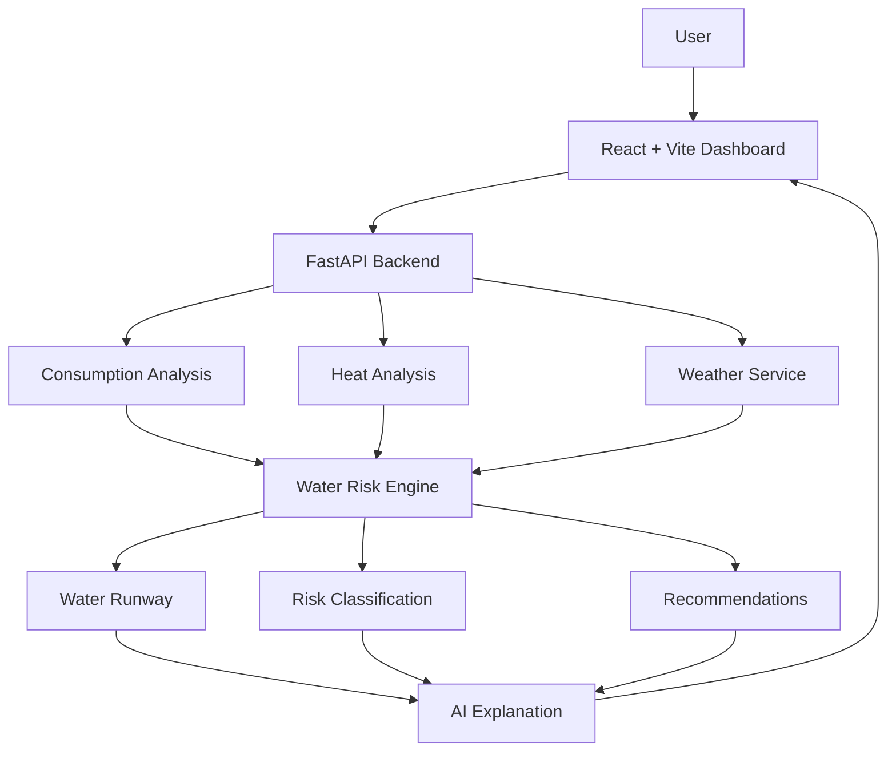

 <div align="center">


# 🌿 CURE — Climate & Utility Risk Engine

**Think ahead. Act before the shortage.**

Climate intelligence for smarter water decisions.

[](https://github.com/dhanush080607/CURE)
[](https://react.dev/)
[](https://fastapi.tiangolo.com/)
[](https://www.python.org/)
[](https://open-meteo.com/)

</div>

---

## 🌊 The Idea

### What if a water tank could tell you when it will become a problem?

CURE combines tank capacity, current water level, consumption history, and weather conditions to estimate how long a water supply may last.

Instead of asking:

> **How much water is left?**

CURE asks:

> **How long will our current water supply last?**


## ⚡ Core Features

| Feature | Description |
|---|---|
| 💧 Water Availability | Calculates the estimated amount of water remaining in a tank. |
| 📈 Consumption Analysis | Analyzes recent daily water consumption and identifies trends. |
| 🌡️ Heat Intelligence | Considers temperature conditions when estimating demand and risk. |
| ☁️ Weather Integration | Retrieves environmental data through weather services. |
| ⏳ Water Runway | Estimates the number of days the available supply may last. |
| 🚦 Risk Classification | Categorizes projected water availability into LOW, WATCH, or HIGH risk. |
| 📋 Recommendations | Provides practical suggestions based on the calculated risk. |
| 🤖 AI Explanation | Turns structured risk results into human-readable explanations. |
| 📊 Interactive Dashboard | Presents water-risk information through a visual interface. |
| 🛡️ Input Validation | Rejects invalid tank levels, capacities, consumption values, and coordinates. |

## 🧠 How CURE Works

### 1. Calculate Available Water

The system estimates the water currently available in the tank.

```text
Available Water = Tank Capacity × (Tank Level / 100)
```

For example:

```text
Tank Capacity = 50,000 L
Current Level = 62%

Available Water = 50,000 × 0.62
                = 31,000 L
```

### 2. Analyze Consumption

CURE uses recent consumption history to estimate typical daily demand and identify whether usage is increasing, decreasing, or remaining relatively stable.

### 3. Consider Climate Conditions

Temperature and weather information can influence the projected demand estimate.

The current adjustment rules are illustrative MVP assumptions. They should not be interpreted as scientifically validated water-demand coefficients.

### 4. Estimate Water Runway

```text
Water Runway = Available Water / Projected Daily Consumption
```

The result represents an estimate of the number of days remaining under the model's assumptions.

### 5. Generate a Risk Signal


| Estimated Runway | Risk Level | Suggested Response |
|---|---|---|
| 4 days or more | 🟢 LOW | Continue monitoring |
| 2 days to less than 4 days | 🟡 WATCH | Review water usage and replenishment plans |
| Less than 2 days | 🔴 HIGH | Prioritize replenishment planning |

These thresholds are configurable project rules, not official public-water-supply standards.

---

## 🏗️ Architecture



The backend performs the calculations and returns structured results to the frontend. The AI layer is intended to explain the calculated results rather than replace the deterministic risk calculations.

## 🤖 AI With Guardrails

CURE separates calculation from explanation.

- **Risk engine:** Calculates water availability, projected demand, runway, and risk level.
- **AI layer:** Explains the resulting information in a readable format.
- **Dashboard:** Presents the results so users can understand the situation.

> **The risk engine calculates. The AI explains.**

AI explanations should not be treated as a substitute for verified environmental data or professional water-management advice.

## 🛠️ Technology Stack

| Layer | Technology |
|---|---|
| Frontend | React, Vite |
| Styling | Tailwind CSS |
| Charts | Recharts |
| Backend | FastAPI |
| Language | Python |
| Data Validation | Pydantic |
| HTTP Requests | HTTPX |
| Weather Data | Open-Meteo and supported fallback services |
| AI | Ollama, where configured |
| Version Control | Git and GitHub |
| Frontend Hosting | Vercel |
| Backend Hosting | Render |

*The AI provider and hosting configuration may differ between local development and deployment.*

---

## 🚀 Getting Started

### Prerequisites

Install the following tools:

- [Git](https://git-scm.com/downloads)
- [Python](https://www.python.org/downloads/)
- [Node.js and npm](https://nodejs.org/)
- [Ollama](https://ollama.com/download), if required by your local AI configuration

### 1. Clone the Repository

```bash
git clone https://github.com/dhanush080607/CURE.git
cd CURE
```

### 2. Configure the Backend

Open a terminal in the repository root:

```powershell
cd backend
python -m venv venv
```

Activate the virtual environment on Windows PowerShell:

```powershell
.\venv\Scripts\Activate.ps1
```

Install the backend dependencies:

```powershell
python -m pip install -r requirements.txt
```

Start the FastAPI server:

```powershell
python -m uvicorn app.main:app --reload
```

Backend URL:

`http://127.0.0.1:8000`

Interactive API documentation:

`http://127.0.0.1:8000/docs`

### 3. Configure the Frontend

Open a **second terminal** from the repository root:

```powershell
cd frontend
npm install
npm run dev
```

Frontend URL:

`http://localhost:5173`

### 4. Configure Local AI (If Required)

If the backend is configured to use Ollama, download the configured model:

```bash
ollama pull llama3.2:3b
```

Make sure the Ollama service is running and the backend's AI configuration points to the correct model and service URL.

If your deployment uses a different AI provider, follow that provider's configuration instead.

### 5. Verify the Application

- Open the frontend in your browser.
- Confirm that the backend starts successfully.
- Open the API documentation and check the available endpoints.
- Test weather retrieval and water-risk calculation.
- Check the browser console and backend logs if a request fails.

---

## 🌐 Deployment

CURE uses a separate frontend and backend deployment.

| Component | Platform | Configuration |
|---|---|---|
| Frontend | Vercel | React/Vite application |
| Backend | Render | FastAPI application |

### Frontend configuration

Set the frontend's backend API base URL in Vercel environment variables if the source code uses that variable:

```text
VITE_API_BASE_URL=https://cure-1s0x.onrender.com
```

The frontend must read this variable in its API client. Adding the variable alone does not change hardcoded API URLs.

### Backend configuration

Ensure the backend:

- Starts using the configured Render port.
- Allows requests from the deployed frontend through CORS.
- Has the necessary environment variables and AI configuration.
- Handles unavailable weather services gracefully.

**Deployment note:** The application URLs and environment settings should be verified against the current deployment before being treated as production-ready.

---

## 📁 Project Structure

```text
CURE/
├── backend/
│   ├── app/
│   │   ├── ai/
│   │   ├── api/
│   │   ├── risk/
│   │   ├── services/
│   │   ├── database.py
│   │   └── main.py
│   └── requirements.txt
│
├── frontend/
│   ├── public/
│   ├── src/
│   │   ├── assets/
│   │   ├── App.jsx
│   │   ├── App.css
│   │   ├── index.css
│   │   └── main.jsx
│   ├── package.json
│   └── vite.config.js
│
├── assets/
│   ├── cure-header.svg
│   ├── cure-flow.svg
│   ├── cure-risk.svg
│   └── cure-footer.svg
│
├── .gitignore
└── README.md
```

*This is the documented high-level structure. Update it if the actual repository contains additional files or a different layout.*

## 🛡️ Validation and Reliability

CURE's backend should validate inputs before performing risk calculations.

Examples of invalid inputs include:

- Non-positive tank capacity.
- Tank level below 0% or above 100%.
- Negative consumption values.
- Latitude outside −90° to 90°.
- Longitude outside −180° to 180°.

Weather-service failures should return a clear error response rather than silently presenting unavailable data as real measurements.

## 🔭 Roadmap

### Current Focus

- [x] Water runway calculation
- [x] Consumption analysis
- [x] Consumption trend detection
- [x] Heat-aware risk assessment
- [x] Weather integration
- [x] Risk classification
- [x] Recommendations
- [x] Interactive dashboard
- [x] Input validation

### Planned Improvements

- [ ] Historical demand forecasting
- [ ] Calibrated demand prediction
- [ ] Tanker requirement estimation
- [ ] Persistent storage for historical risk records
- [ ] Multi-tank monitoring
- [ ] Automated alerts
- [ ] IoT tank-sensor integration
- [ ] Community-level water intelligence

## 🤝 Contributing

Contributions that improve reliability, usability, documentation, and environmental impact are welcome.

1. Fork the repository.
2. Create a branch for your change.
3. Make a focused improvement.
4. Run the relevant checks.
5. Submit a pull request with a clear explanation of the change.

Please keep documentation aligned with the actual implementation and avoid introducing unverified claims about system capabilities.

## 🌍 Why CURE?

Water scarcity is not only about how much water is available today. It is also about understanding how long that supply may last.

CURE aims to turn climate and consumption signals into practical decisions that help users plan ahead.

### Potential Applications

- 🏠 Homes and apartments
- 🏫 Schools and educational institutions
- 🏥 Hospitals
- 🏭 Industrial facilities
- 🏙️ Residential communities

## 👥 Contributors

<div align="center">

<a href="https://github.com/dhanush080607">

</a>
&nbsp;&nbsp;
<a href="https://github.com/KCDharshan9">

</a>
&nbsp;&nbsp;
<a href="https://github.com/FaheedBasha123">

</a>

<br/><br/>

**Dhanush · KCDharshan9 · FaheedBasha123**

</div>

---

## 🏆 Built for Environmental Hacks 2026

<div align="center">

[](https://github.com/dhanush080607/CURE)

**🌱 Turning climate signals into practical utility decisions.**


**CURE — Climate & Utility Risk Engine**

*Think ahead. Act before the shortage. 🌿*

</div>
