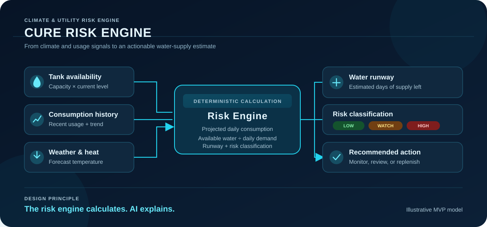
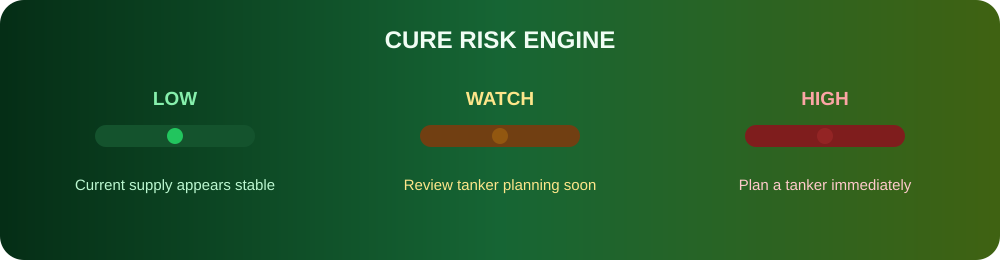
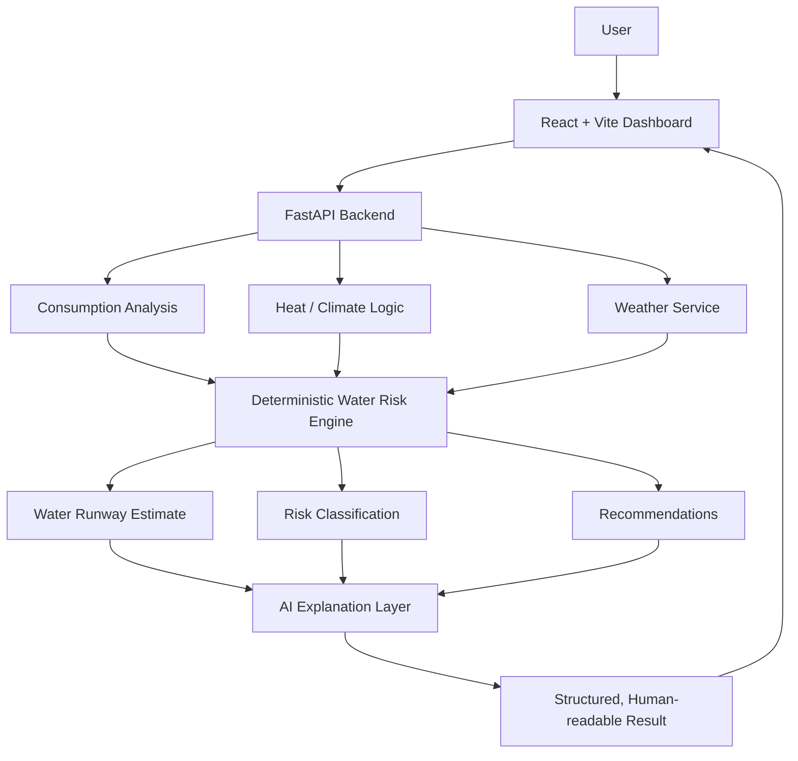
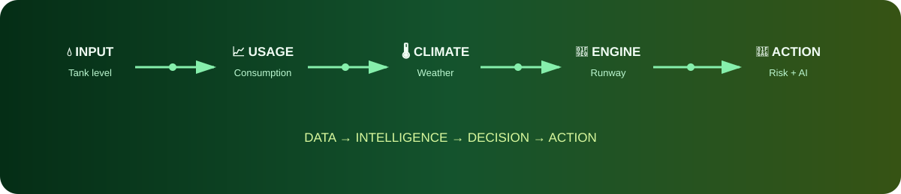

<div align="center">



# 🌿 CURE — Climate & Utility Risk Engine

### Think ahead. Act before the shortage.

**Climate-aware water-risk intelligence that turns tank levels, consumption patterns, and weather conditions into actionable decisions.**

[](https://github.com/dhanush080607/CURE)
[](https://react.dev/)
[](https://fastapi.tiangolo.com/)
[](https://www.python.org/)
[](https://open-meteo.com/)

[Problem](#-the-problem) · [Solution](#-our-solution) · [How It Works](#-how-it-works) · [Impact](#-environmental-and-social-impact) · [Architecture](#️-technical-architecture) · [Run Locally](#-run-locally)

</div>

---

## 🌍 The Problem

Water shortages are often recognized only after supply becomes critically low. Knowing a tank's current level is useful, but it does not answer the more urgent question:

> **How long will the remaining water last under current usage and weather conditions?**

Homes, apartment communities, schools, hospitals, and facilities may need to plan water use and replenishment before a shortage occurs. Consumption patterns and hot weather can affect demand, yet these signals are often considered separately.

CURE explores a practical way to bring these signals together and make water-supply risk easier to understand.

## 💡 Our Solution

**CURE (Climate & Utility Risk Engine)** is a climate-aware water-risk dashboard that estimates the number of days a water supply may last and communicates the resulting risk.

It combines:

- 💧 **Tank availability:** tank capacity and current level.
- 📈 **Consumption intelligence:** recent usage and trend.
- 🌡️ **Climate context:** temperature and available forecast data.
- 🧮 **Deterministic risk calculation:** estimated daily demand and water runway.
- 🚦 **Action-oriented output:** LOW, WATCH, or HIGH risk with recommendations.
- 🤖 **AI-assisted explanation:** human-readable summaries of calculated results.

CURE is designed to support earlier planning—not to replace official water advisories, sensor systems, or professional water-management decisions.



## ✨ What Makes CURE Useful?

### 1. From a static level to a time-based estimate
Instead of displaying only the percentage of water remaining, CURE estimates the potential number of days before the supply runs out.

### 2. Climate-aware reasoning
Weather and temperature can influence the demand estimate, helping the system consider environmental context alongside usage history.

### 3. Explainable risk calculation
Core water-risk values are calculated by the backend. AI is used to explain the result, rather than being treated as the source of the risk calculation.

### 4. Action-oriented results
The dashboard groups runway estimates into risk levels and provides a practical next step, helping users interpret the result quickly.

### 5. Modular implementation
A React frontend communicates with a FastAPI backend, keeping the interface, weather integration, and risk logic in separate layers.

> **Core principle: The risk engine calculates. The AI explains.**

## 🧠 How It Works

### Step 1 — Calculate available water

```text
Available Water = Tank Capacity × (Tank Level / 100)
```

Example:

```text
Tank capacity: 50,000 L
Tank level:    62%
Available:     31,000 L
```

### Step 2 — Analyze consumption

CURE processes recent daily consumption values to estimate typical demand and identify whether usage is increasing, decreasing, or relatively stable.

### Step 3 — Incorporate climate context

Available weather data and temperature conditions can adjust the projected demand estimate. Current adjustment factors are **MVP heuristics**, not scientifically validated coefficients; they require calibration against real-world observations before operational use.

### Step 4 — Estimate water runway

```text
Water Runway = Available Water / Projected Daily Consumption
```

This produces an estimate of how many days the supply may last under the model's assumptions.

### Step 5 — Communicate the risk


| Estimated runway | Risk signal | Suggested response |
|---|---|---|
| 4 days or more | 🟢 LOW | Continue monitoring |
| 2 days to less than 4 days | 🟡 WATCH | Review usage and replenishment plans |
| Less than 2 days | 🔴 HIGH | Prioritize replenishment planning |

These thresholds are configurable project rules, not official public-water-supply standards.

## 🌱 Environmental and Social Impact

CURE focuses on **anticipatory water planning**: making potential shortages visible early enough for people to review usage and plan replenishment.

Potential applications include:

- 🏠 Homes and apartment communities
- 🏫 Schools and educational institutions
- 🏥 Hospitals and care facilities
- 🏭 Industrial and commercial facilities
- 🏙️ Community-level water planning

### Intended impact

- **Earlier awareness:** show an estimated runway instead of only a tank percentage.
- **Better planning:** highlight when supply may need attention.
- **Climate context:** consider weather alongside consumption.
- **More accessible information:** translate calculated results into clear explanations.

These are intended benefits. CURE has not yet established quantified water savings or measured environmental impact; those claims would require field testing and baseline comparisons.

## 🏗️ Technical Architecture



### Technology stack

| Layer | Technology | Role |
|---|---|---|
| Frontend | React + Vite | Interactive dashboard |
| Styling | Tailwind CSS | Interface styling |
| Charts | Recharts | Data visualization |
| Backend | FastAPI | API and application logic |
| Language | Python | Risk and consumption calculations |
| Validation | Pydantic | Request-data validation |
| HTTP | HTTPX | Asynchronous HTTP requests |
| Weather | Open-Meteo and configured fallback services | Weather data |
| AI | Ollama where configured | Natural-language explanation |
| Deployment | Vercel + Render | Frontend and backend hosting |

*Actual AI configuration and service availability depend on the deployment environment.*

## 🛡️ Reliability and Responsible Use

CURE is an MVP decision-support tool. Its estimates depend on the quality of the inputs, weather-service availability, and the assumptions in the demand model.

Current design considerations:

- Validate tank capacity, tank level, consumption values, and coordinates.
- Handle unavailable weather services with a clear error response.
- Keep calculated risk values separate from generated explanations.
- Communicate estimates as estimates, not guarantees.
- Avoid claiming measured savings or predictive accuracy without evaluation data.

### What needs further validation?

- Calibrate temperature-related demand adjustments using observed consumption.
- Compare runway predictions with actual tank depletion.
- Evaluate forecast errors across different seasons and locations.
- Test reliability when weather data or AI services are unavailable.
- Conduct pilot deployments before making operational recommendations.

## 🧪 Testing and Evaluation

CURE includes backend input validation and risk-calculation logic. The following evaluation plan describes how the system should be assessed; it is not a claim that every test has already been completed.

| Evaluation area | What to verify |
|---|---|
| Input validation | Invalid capacity, tank level, consumption, and coordinates are rejected |
| Calculation correctness | Available water and runway match independently calculated examples |
| Risk classification | Boundary values produce the intended risk level |
| Weather resilience | Unavailable weather services produce clear errors or configured fallback behavior |
| API integration | Frontend requests reach the backend and handle failures correctly |
| AI guardrails | Explanations reflect the supplied risk result without inventing calculations |
| Usability | Users can understand the runway, risk level, and recommended response |

## 🚀 Run Locally

### Prerequisites

- [Git](https://git-scm.com/downloads)
- [Python](https://www.python.org/downloads/)
- [Node.js and npm](https://nodejs.org/)
- [Ollama](https://ollama.com/download), if required by your local AI configuration

### 1. Clone the repository

```bash
git clone https://github.com/dhanush080607/CURE.git
cd CURE
```

### 2. Start the backend

From the repository root, open a terminal:

```powershell
cd backend
python -m venv venv
.\venv\Scripts\Activate.ps1
python -m pip install -r requirements.txt
python -m uvicorn app.main:app --reload
```

Backend: `http://127.0.0.1:8000`

API documentation: `http://127.0.0.1:8000/docs`

### 3. Start the frontend

Open a second terminal from the repository root:

```powershell
cd frontend
npm install
npm run dev
```

Frontend: `http://localhost:5173`

### 4. Configure local AI if needed

If the local backend is configured to use Ollama, pull the configured model:

```bash
ollama pull llama3.2:3b
```

Ensure the Ollama service is running and the backend points to the correct
model and service URL. Follow the project's actual AI configuration if it
differs.

### 5. Verify the application

- Open the frontend.
- Confirm the backend is running.
- Visit the API documentation.
- Test weather retrieval and water-risk calculation.
- Inspect browser and backend logs if a request fails.

## ☁️ Deployment

The project supports separate frontend and backend hosting.

| Component | Hosting |
|---|---|
| Frontend | Vercel |
| Backend | Render |

### Production API behavior

Without `VITE_API_BASE`, the production frontend runs water-risk analysis in
the browser and saves history only in that browser. Live weather adjustments
and shared backend history are unavailable in this mode. To use the deployed
FastAPI backend, set `VITE_API_BASE` to its base URL in Vercel:

```text
VITE_API_BASE=https://cure-1s0x.onrender.com
```

The backend must allow the deployed frontend origin through its CORS
configuration. Redeploy the frontend after changing its environment variables.

Check live deployment and endpoint availability before relying on it.

## 🗺️ Roadmap

### Next priorities

- [ ] Validate runway predictions against real usage observations
- [ ] Calibrate the demand model
- [ ] Improve weather-service fallback and monitoring
- [ ] Add persistent historical records
- [ ] Estimate replenishment or tanker requirements
- [ ] Support multiple tanks and locations
- [ ] Add configurable alerts
- [ ] Explore IoT tank sensors and community-level dashboards

## 🤝 Contributing

Contributions that improve reliability, explainability, accessibility, and environmental usefulness are welcome.

1. Fork the repository.
2. Create a focused branch.
3. Implement the change.
4. Run relevant tests and checks.
5. Open a pull request describing the change and its verification.

Keep documentation aligned with the actual implementation. Please distinguish implemented features from proposed work.

## 👥 Contributors

<div align="center">

<a href="https://github.com/dhanush080607">

</a>
&nbsp;&nbsp;
<a href="https://github.com/KCDharshan9">

</a>
&nbsp;&nbsp;
<a href="https://github.com/FaheedBasha123">

</a>

<br/><br/>

**Dhanush · KCDharshan9 · FaheedBasha123**

</div>

---

<div align="center">



### 🌿 CURE — Climate & Utility Risk Engine

**Turning climate signals into practical water decisions.**

*Think ahead. Act before the shortage.*

</div>
